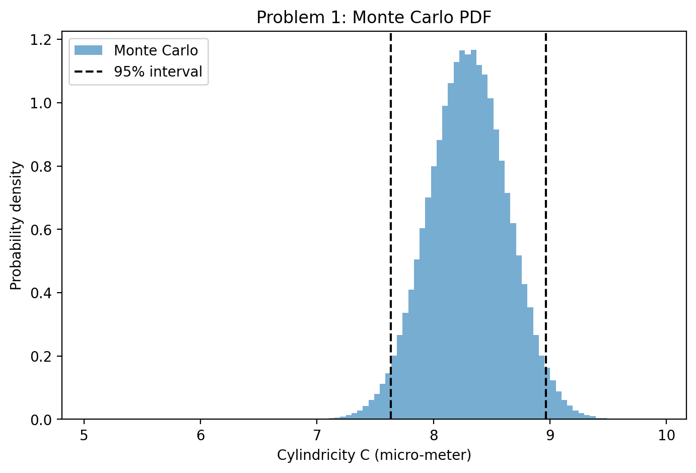
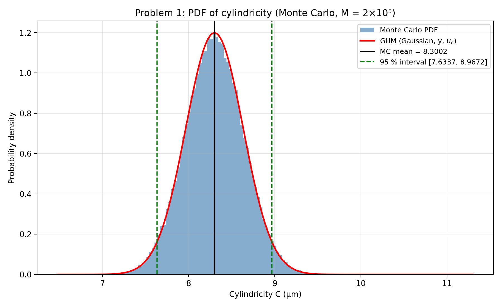
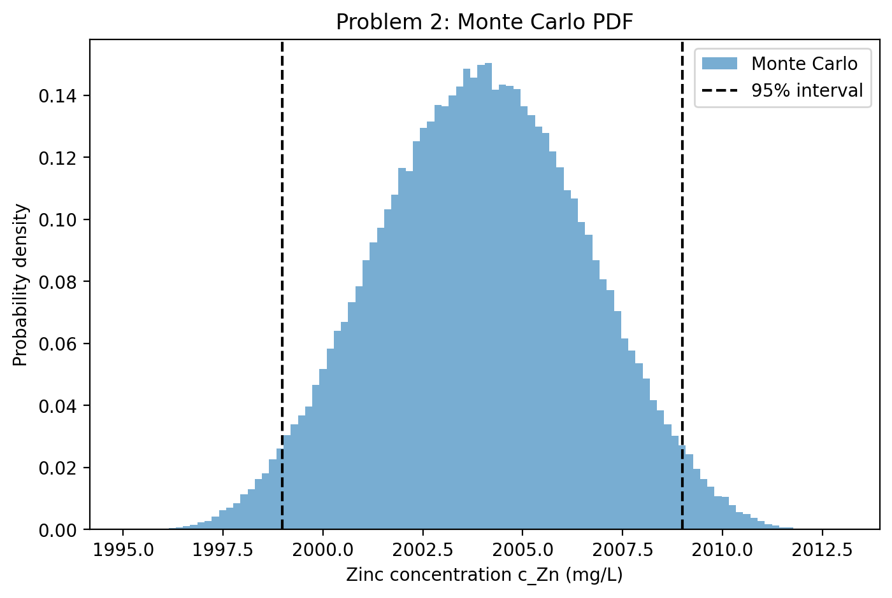
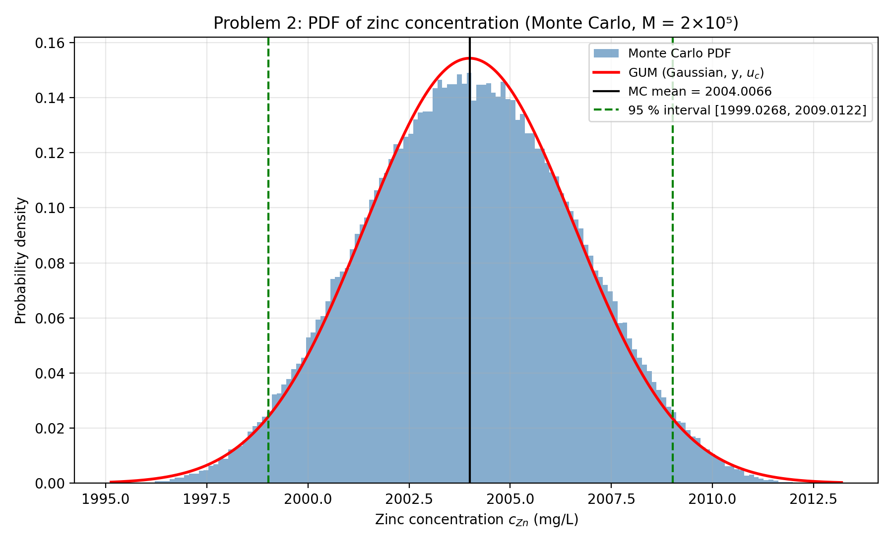

# Uncertainty Analysis – GUM and Monte Carlo Simulation

This repository contains Python solutions for the two assignment problems done as a course project for ME3112 – Metrology and Instrumentation. Each problem is solved using the analytical GUM approach and Monte Carlo simulation with 200,000 trials.

---

## Problem 1 – Cylindricity measurement

Five repeated measurements: `8.2, 8.5, 8.1, 8.4, 8.3 µm`.

Measurement model:

\[
C = C_{\mathrm{ind}} + \delta_{\mathrm{cal}} + \delta_{\mathrm{res}} + \delta_{\mathrm{align}}
\]

Uncertainty sources:
- Repeatability of the five readings (Type A).
- Calibration: normal distribution, expanded uncertainty 0.6 µm with \(k=2\).
- Resolution: uniform distribution over ±0.05 µm.
- Setup and alignment: symmetric triangular distribution from −0.30 µm to +0.30 µm, mode at zero.

### Independently written program output



### AI-generated program output



---

## Problem 2 – Zinc concentration estimation

Measurement model:

$$
C_{\mathrm{Zn}} = \frac{1000mP}{V}
$$

where \(m\) is zinc mass in mg, \(P\) is purity, and \(V\) is final solution volume in mL.

Input distributions:
- Purity: uniform, 0.9985 to 1.0005.
- Mass: normal, mean 300.75 mg and standard deviation 0.009 mg.
- Filling volume: triangular, minimum 149.6 mL, mode 150 mL, maximum 150.4 mL.
- Repeatability contribution to volume: rectangular, total range 0.09 mL, centred at zero.
- Temperature contribution to volume: normal, uncertainty 0.1 mL at 95% confidence.

### Independently written program output



### AI-generated program output



---

## Running the programs

Install dependencies:

```bash
pip install -r requirements.txt
```

Run the independently written programs:

```bash
python uncertainty_problem_1.py
python uncertainty_problem_2.py
```

Run the AI-generated program:

```bash
python uncertainty_analysis.py
```

The scripts print numerical results and save their histogram PNG files in the current working directory.

## Comparison notes

- Each implementation uses 200,000 Monte Carlo trials.
- The independently written Problem 1 code reports an expanded uncertainty using \(k=2\) for its rounded interval and also calculates a Student-t coverage factor.
- The AI-generated code uses the Welch–Satterthwaite effective degrees of freedom for Problem 1.
- For Problem 2, the independently written code reports expanded uncertainty using \(k=2\), while the AI-generated code uses the 95% normal coverage factor (approximately 1.96).
- Small differences between Monte Carlo outputs are expected because the scripts use different random seeds and sampling implementations.
- The AI-generated program also prints a GUM-validation check against the Monte Carlo interval using its implemented tolerance. This is separate from comparing estimated means and standard uncertainties.

## AI prompt and verification

The assignment requires the prompts used to generate the AI program and a record of corrections made after verification.

**Add the exact prompt(s) used to generate `uncertainty_analysis.py` here.** The prompt was not present in the supplied files, so it has not been fabricated.

Document any corrections made to the AI-generated code and how they were checked. If no corrections were required, state that explicitly.

## References

1. BIPM, IEC, IFCC, ILAC, ISO, IUPAC, IUPAP and OIML (2008). *Evaluation of measurement data – Supplement 1 to the Guide to the expression of uncertainty in measurement – Propagation of distributions using a Monte Carlo method*, JCGM 101:2008.
2. Veen, A. M. H. van der and Cox, M. G. (2021). “Getting started with uncertainty evaluation using the Monte Carlo method in R.” *Accreditation and Quality Assurance*, 26, 129–141. https://doi.org/10.1007/s00769-021-01469-5
